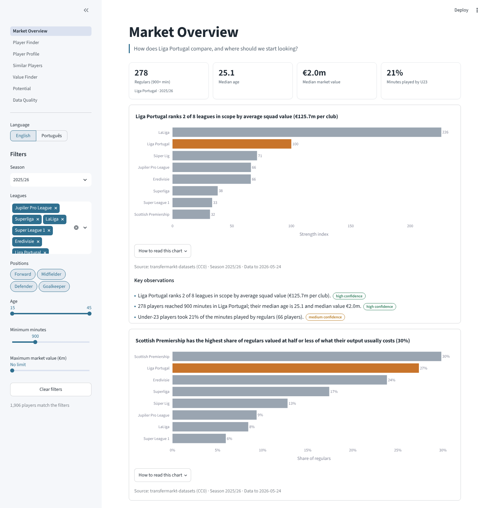
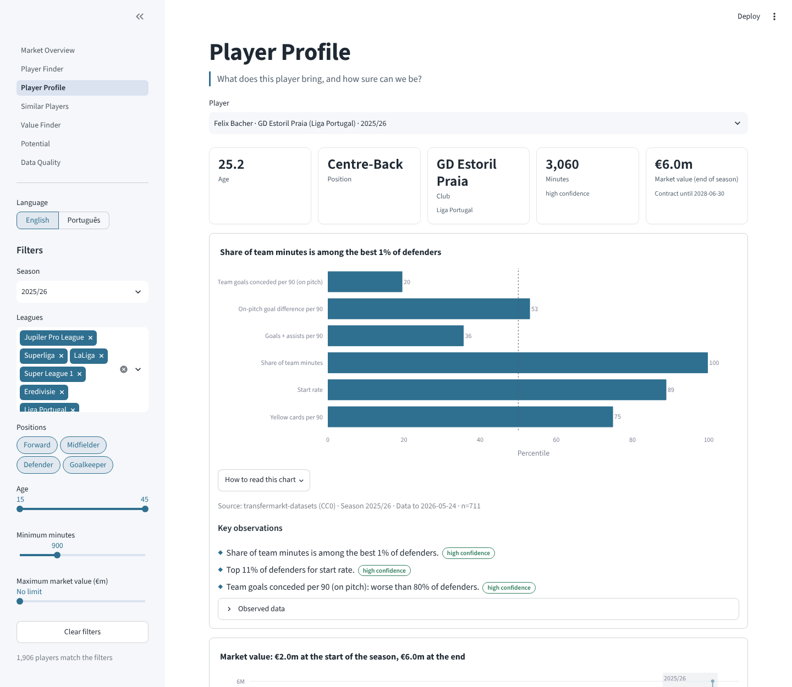
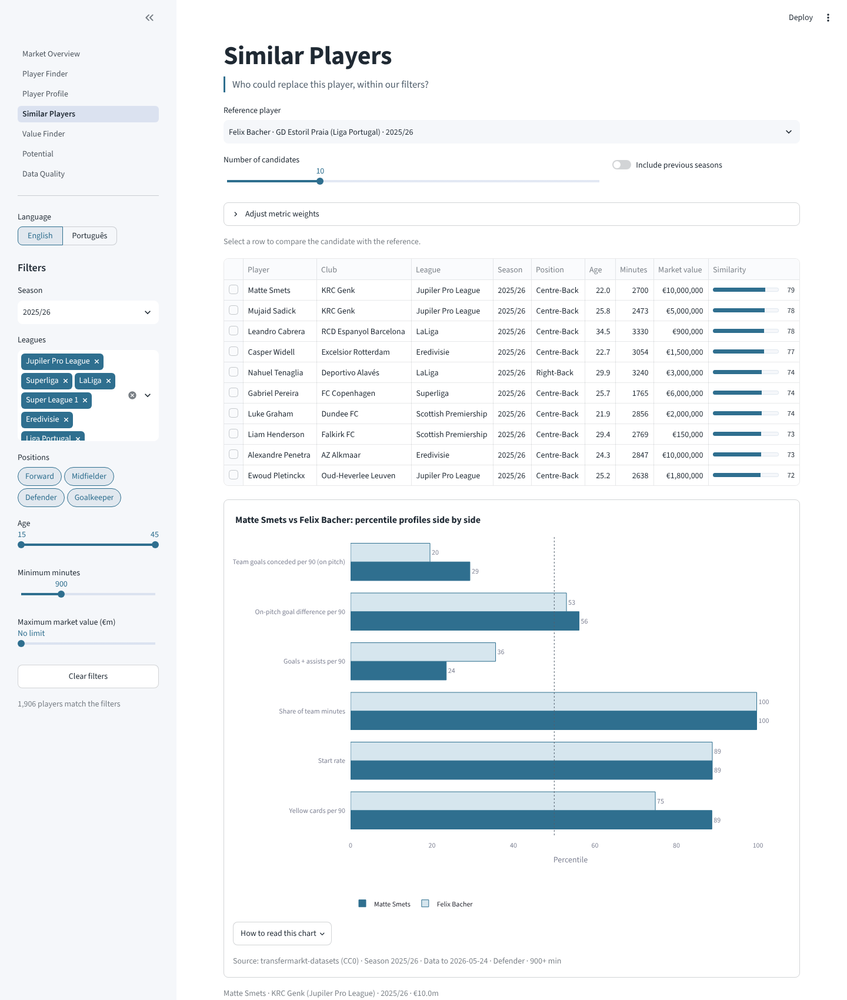
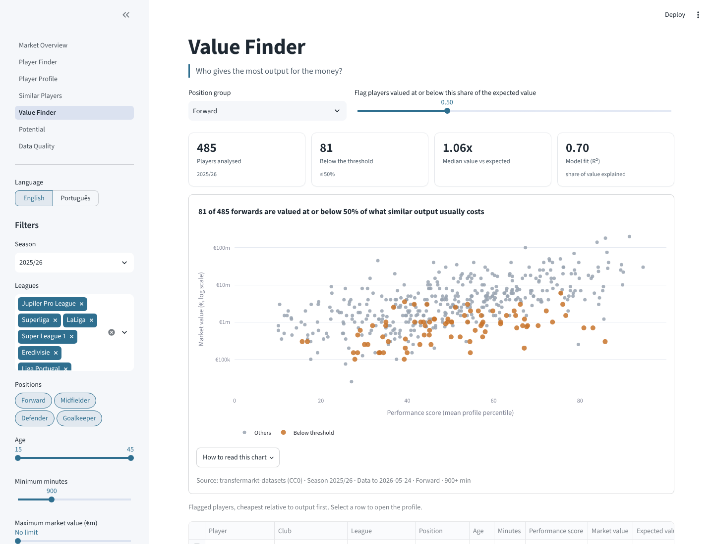

# Football Recruitment Analytics

A scouting tool for a club that has to recruit well without spending much: find players in Liga
Portugal and seven comparable leagues, profile them, compare them, and say clearly how much the
data behind each conclusion can be trusted.

I built it as a portfolio project while applying for a junior data analyst role in player
recruitment at Casa Pia AC. I wanted to show the work the role involves, not only describe it:
taking open data, turning it into metrics a scout can use, and explaining the result to someone
who has five minutes and a decision to make.



## Why this project

Casa Pia buys cheaply and sells to grow. Since July 2023 the data records 54 arrivals at the
club, and the highest fee paid was €900k. A club like that cannot win bidding wars, so it has to
see value earlier than other clubs do, often in leagues that get less attention, and it has to
explain its choices to people who do not read percentiles for fun.

That shaped three decisions:

1. **Leagues where a club with this budget can actually buy.** Liga Portugal plus LaLiga, Belgium,
   the Netherlands, Greece, Turkey, Denmark and Scotland, seasons 2023/24 to 2025/26.
2. **Every number comes with its evidence.** A player with 400 minutes and a player with 3,000
   minutes can have the same percentile; they do not deserve the same confidence. Every insight in
   the app shows a confidence badge and the sample behind it.
3. **Honest about what is missing.** Public data for these leagues has no xG, passing or defensive
   actions. Instead of hiding that, the app lists those metrics as "not available" on every
   profile, so nobody mistakes a usage-and-output profile for a full scouting report.

### How it maps to the role

| What the role asks for | Where it is in this project |
| --- | --- |
| Identify and profile players with data | Player Finder, Player Profile and Similar Players pages |
| Dashboards and reports | A seven-page Streamlit app, bilingual, plus a written [case study](docs/case-study.md) |
| Metrics and models for performance and potential | Per-90 and on-pitch metrics, percentiles by position, a market value model, potential signals ([methodology](docs/methodology.md)) |
| Internal tools, pipelines and automated workflows | A reproducible pipeline from a pinned, checksummed download to a tested analysis table, with CI on every push to main and every pull request |
| Practical use of AI | An optional AI scouting-notes feature with number checking, and an honest account of how I used a coding assistant ([below](#how-i-used-ai)) |
| Turn complex data into simple insights | Automatic insights in plain language, each with a confidence level and the observed data behind it |
| Portuguese and English | The whole interface switches between English and Portuguese |

## What the app does

Seven pages, all sharing the same filters (season, leagues, positions, age, minutes, value cap):

- **Market Overview**: a quick read of Liga Portugal in the chosen season and how it compares
  with the other leagues, plus three starting lists: young regulars, players valued below their
  output, and contracts about to end.
- **Player Finder**: filter the whole pool and export the list to CSV.
- **Player Profile**: one player's percentiles against his position group, market value over
  time, minutes by season, and a few automatic observations with a confidence badge.
- **Similar Players**: who plays a similar statistical role, useful when a key player leaves.
- **Value Finder**: players whose market value is low for their output, age and league.
- **Potential**: young players who already play more than other regulars of their age.
- **Data Quality**: coverage per league, completeness of key fields and a status board, so the
  person reading the other pages knows what the data can and cannot carry.

| Player Profile | Similar Players | Value Finder |
| --- | --- | --- |
|  |  |  |

## The case study

The tool is only useful if it answers a real question, so I used it on one: **Casa Pia's
most-used player in 2025/26, right-back Gaizka Larrazabal, was on a contract ending in June 2026.
Who are three low-cost right-backs worth scouting first?**

The answer, the reasoning, the risks and the limits are in
[docs/case-study.md](docs/case-study.md), written the way I would hand it to a head of
recruitment. Every number in it can be reproduced with `python scripts/case_study.py`.

## Running it

You need Python 3.11 or newer. The data is not in the repository (see [Data](#data)); the first
script downloads it.

```bash
pip install -e ".[dev]"
python scripts/fetch_data.py      # downloads the source once, checks its checksum, extracts the scope
python scripts/build_dataset.py   # builds the player x season x league table
streamlit run app.py
```

On Windows, use `py` instead of `python`, and forward slashes in paths if you use Git Bash.

To check everything works:

```bash
ruff check .
pytest            # unit tests plus every page rendered in both languages, coverage >= 90%
```

The same checks run on GitHub Actions for Python 3.11, 3.12 and 3.13.

## Data

| | |
| --- | --- |
| Source | [transfermarkt-datasets](https://github.com/dcaribou/transfermarkt-datasets) (maintained by dcaribou) |
| License | CC0 1.0 (public domain) |
| Version | Pinned by SHA-256 in `config/settings.yaml`; the download fails if the file changes |
| Coverage | 8 leagues, 3 seasons, 6,260 league games, 6,782 players, games up to 24 May 2026 |
| In the repository | No raw or processed data. `data/` is git-ignored and rebuilt by the scripts |

I tested other sources before choosing this one. FBref, Sofascore and WhoScored have richer
metrics, but their terms do not allow automated collection, so they are out. Club Elo would have
been a good league-strength measure, but it blocks scripted access, so league strength is
computed from the same open dataset instead (see the methodology).

Market values are crowd estimates, not fees. The app says so next to every value chart.

## Methodology in short

Full details, with the reasoning behind each choice, are in
[docs/methodology.md](docs/methodology.md).

- **Grain:** one row per player, season and league.
- **On-pitch metrics:** from lineups and substitutions I rebuild when each player was on the pitch,
  and count the goals his team scored and conceded in that time.
- **Percentiles:** against the same position group across all eight leagues in the same season,
  only players with 900+ minutes; "lower is better" metrics are flipped so 100 is always best.
- **Confidence:** high from 1,800 minutes, medium from 900; the comparison group needs at least
  30 players for medium and 100 for high. The weakest of the two decides.
- **League strength:** average squad market value relative to Liga Portugal (= 100), with
  European results shown alongside as supporting evidence.
- **Value model:** a simple regression of market value on output, age and league strength, per
  position group (R² between 0.65 and 0.75). Players far below the line are worth a look.
- **Similarity:** distance between standardized profiles, turned into a 0-100 score.
- **Potential:** signals, not predictions. Minutes and starts compared with regulars of the same
  age, plus market value growth.

## Limitations

I would rather a scout knew these before using the tool than after:

- **No defensive, passing or shot-quality metrics.** The profiles describe how much a player is
  trusted and what happens to his team's scoreline when he plays, not how he plays.
- **On-pitch goal difference reflects the team** as much as the player.
- **League strength is an approximation.** Squad value is a reasonable proxy, but European
  evidence in the data covers only the Champions League and its qualifiers.
- **Three seasons only.** Career history before 2023/24 is not included, which matters most for
  the potential page.
- **Regular season only** for leagues with play-off rounds.
- **Market value is not a transfer fee,** and contract dates are a snapshot from July 2026.

None of this replaces watching players. The aim is to decide **who to watch first** and to make
the conversation with the sporting director faster and more honest.

## How I used AI

The job asks for practical use of AI, so here is how it was used in this project.

**Building it.** I worked with an AI coding assistant (Claude) throughout. I defined the
question, the scope, the leagues, the rules of the project and what "done" meant at each step;
the assistant wrote a large part of the code and tests, and I reviewed, ran and challenged it. A
few examples of where the review changed the result:

- **Sources.** Scraping FBref would have given much richer metrics. We dropped it because its
  terms do not allow it, and dropped Club Elo when it blocked scripted access rather than work
  around the block.
- **Similarity.** The first version used cosine similarity, and almost every player scored
  between 98 and 100, which tells a scout nothing. It was replaced by a distance-based score
  where a typical pair of players scores around 30.
- **Potential.** The first version compared young players with everyone their age, so simply
  playing made 63% of them look promising. Comparing them with regulars of the same age brought
  that down to a meaningful 30%.
- **Fact-checking.** Before committing the case study I checked every claim against the data.
  Two were wrong in the first draft (who had the highest value in the squad, and how the club's
  arrivals split between fees, free transfers and unknown fees) and were corrected.

**In the product.** The Player Profile page can draft a short written scouting note with an LLM.
It only receives the player's computed facts, and every number in its answer is checked against
those facts before it is shown. The feature exists and is tested, but it is **switched off** in
this repository; the next section explains how to turn it on.

## AI Scouting Notes (optional, disabled)

The Player Profile page can show a short written profile drafted by an LLM. The feature is
**implemented and tested but switched off in this repository**: with the default configuration
nothing about it appears in the app, and no request is ever sent to a model.

**What the model receives.** Only a JSON of facts built from the selected player's row
(`src/scouting/llm_notes.py`, `build_facts`): name, club, league, season, position, age,
minutes, games and starts, the position group's metrics with their percentiles, the size of the
comparison group, the confidence level, market value and expected value, the league strength
index, the contract date, the automatic insights and the list of metrics public data does not
cover. No web access and no free text from users.

**Safeguards.**

- The instructions forbid any number, event or opinion that is not in the facts, and require
  the text to state the confidence level and the main data gaps.
- Every number in the answer is checked against the facts (`check_numbers`); numbers that
  cannot be traced are shown as a warning under the note.
- The note is labelled as AI-generated, with the model name.
- API errors never break the page; each note is cached per player and language while the app runs.

**How to enable it**

1. Install the optional dependency:

   ```bash
   pip install -e ".[llm]"
   ```

2. Set the API key as an environment variable (never in a file that is committed; `.env` is
   git-ignored):

   ```powershell
   # Windows PowerShell (current session)
   $env:ANTHROPIC_API_KEY = "your-key"
   ```

   ```bash
   # macOS / Linux
   export ANTHROPIC_API_KEY="your-key"
   ```

3. Turn the feature on in `config/settings.yaml`:

   ```yaml
   llm:
     enabled: true
     provider: anthropic
     model: claude-haiku-5-5       # any model name your key can use
     api_key_env: ANTHROPIC_API_KEY
     max_tokens: 600
   ```

4. Restart the app. The Player Profile page now shows an **AI Scouting Note** card with a
   *Generate note* button. Each click sends one request to the provider, which is billed to the
   key's account.

To switch it off again, set `enabled: false` or unset the environment variable. If one of the
three conditions is missing, the feature stays hidden.

## Project structure

```text
app.py                  Streamlit entry point (navigation, language)
pages/                  one file per page
config/settings.yaml    sources, scope, thresholds, AI settings: no number is hard-coded elsewhere
scripts/                fetch_data, build_dataset, case_study
src/scouting/
  ingest/               download, checksum, schema check, extraction to Parquet
  transform/            on-pitch stints and the player x season x league table
  metrics/              catalog, percentiles, league strength, value, similarity, potential
  insights.py           automatic bilingual insights with confidence
  quality.py, health.py data-quality checks and the status board
  case_study.py         the rule-based shortlist used in the case study
  llm_notes.py          optional AI scouting notes
  ui/                   theme, translations, filters, charts, shared components
tests/                  synthetic data only; no real player data in the tests
docs/                   methodology, case study, screenshots
```

## About this project

This is an independent portfolio project. It is not affiliated with, endorsed by or built for
Casa Pia AC or any other club. Club and player names come from the public dataset and are used
only to show how the analysis works.

Code is released under the [MIT License](LICENSE). The data remains under its source's licence.

---

## Resumo (PT)

Ferramenta de apoio ao recrutamento para um clube com orçamento curto: encontrar, perfilar e
comparar jogadores da Liga Portugal e de sete ligas comparáveis (2023/24 a 2025/26), com dados
abertos (transfermarkt-datasets, CC0) e sempre com o nível de confiança de cada conclusão.

Fiz este projeto para a candidatura a analista de dados júnior de recrutamento do Casa Pia AC. A
aplicação tem sete páginas (visão do mercado, pesquisa, perfil, jogadores semelhantes, valor,
potencial e qualidade dos dados), funciona em inglês e português, e é acompanhada de um
[caso de estudo](docs/case-study.md): três alternativas de baixo custo para substituir o
lateral-direito Gaizka Larrazabal.

Os dados públicos destas ligas não têm métricas defensivas, de passe nem xG; a aplicação diz isso
em cada perfil em vez de o esconder. Usei um assistente de programação com IA para escrever boa
parte do código, com as decisões, a revisão e a verificação dos factos do meu lado. As notas de
scouting por IA estão implementadas mas desligadas; a secção *AI Scouting Notes* explica como
ativá-las. Projeto independente, sem ligação ao Casa Pia AC.
